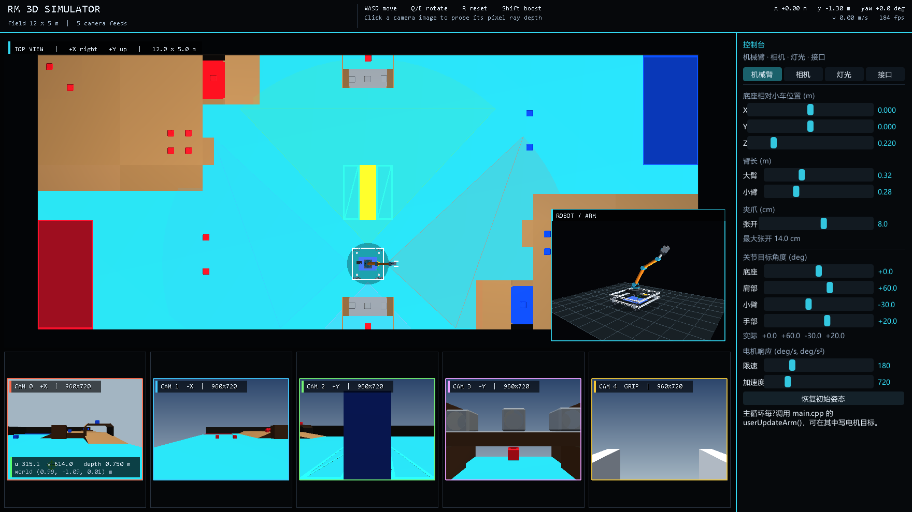
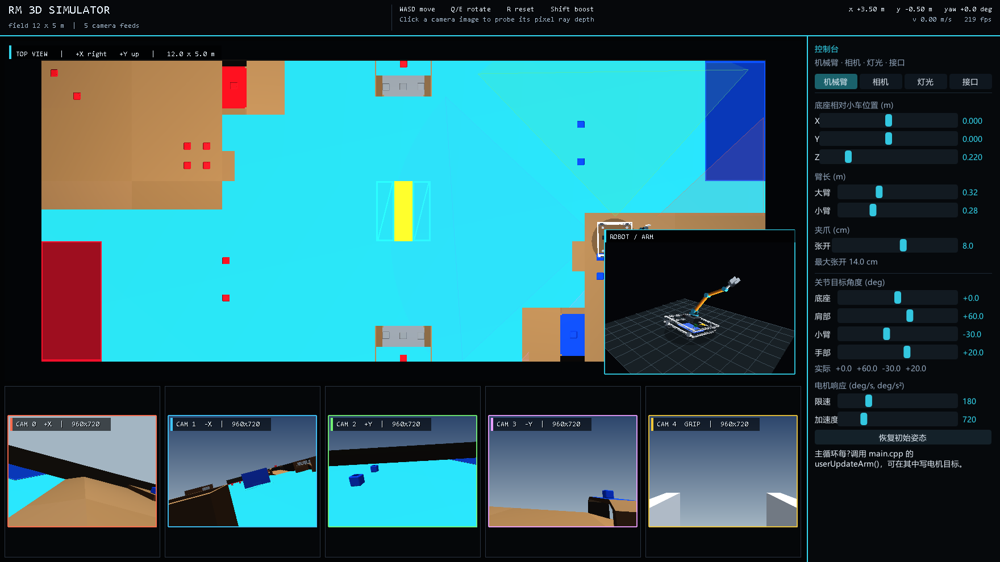

# RM 3D Camera Simulator

用于 RoboMaster 校内赛/视觉算法联调的轻量 3D 仿真器。当前版本包含：

- 12 m x 5 m 的真实 STEP 场地网格、场地材质色、中央台子和主要碰撞体；
- 58 cm x 58 cm 的白色铝型材四麦轮小车，由本地 SolidWorks `SLDPRT` 零件烘焙；
- 小车四周有四个保险杠碰撞箱，参与台阶、围墙和场地结构碰撞；
- 26 个 12 cm 矿石立方体，灰、红、蓝三色，并参与碰撞；
- 4 自由度机械臂（底座回转 + 肩部俯仰 + 肘部 + 手腕）及最大 14 cm 平行夹爪；
- 地形接触物理：小车在坡道上俯仰/侧倾，驶出平台边缘会受重力下落；
- 右侧 Dear ImGui 控制栏，可调机械臂、相机高度、灯光；
- 四路车体相机 + 一路夹爪相机，共五路画面处理接口；
- 侧栏“接口”页提供四个布尔开关，作为状态传入用户函数；
- 射线深度查询接口。



渲染与窗口只依赖 Win32 + OpenGL；控制栏使用随源码内置的 Dear ImGui（MIT）。不修改环境变量，运行时也不需要安装 CAD 或图像处理库。

## 功能

- 场地坐标系：`+X` 向前（yaw = 0 时），`+Y` 向左，`+Z` 向上，单位米。
- 麦轮底盘：
  - `W/S` 沿车体 `+X/-X` 平移；
  - `A/D` 沿车体 `+Y/-Y` 平移；
  - 平移不会改变车头朝向；
  - `Q/E` 绕 `+Z` 逆时针/顺时针旋转；
  - `R` 回到出生点，`Shift` 加速。
- 五个相机：
  - CAM0：车体 `(+offsetX, 0)`，朝 `+X`；
  - CAM1：车体 `(-offsetX, 0)`，朝 `-X`；
  - CAM2：车体 `(0, +offsetY)`，朝 `+Y`；
  - CAM3：车体 `(0, -offsetY)`，朝 `-Y`；
  - CAM4：夹爪相机，安装在夹爪上方，沿夹爪朝向看，随机械臂运动。

  前四个光心高度由侧栏“相机”页的滑块控制（相对小车原点）；相机随车体一起俯仰、侧倾。CAM4 的高度和朝向由机械臂正运动学自动计算。
- 六画面窗口：上方是完整场地俯视图，下方五路相机画面；俯视图右下角还有一个跟随小车的 **ROBOT / ARM** 3D 模型预览。
- 机械臂有 4 个自由度，侧栏可实时调整：
  - 底座相对小车位置 `X/Y/Z`；
  - 大臂、小臂长度；
  - 夹爪张开量（最大 14 cm）；
  - 4 个关节的目标角；
  - 舵机最大速度和最大加速度。
- 地形物理：
  - 坡道上按四个轮子的接地点拟合车体姿态；
  - 四个轮子都离开支撑面后进入空中，受重力下落；
  - 高台、围栏、木箱和陡峭台阶通过高度场台阶阻挡；
  - 俯视图中车辆高度、相机位姿和机械臂都使用同一套车体姿态。
- 相机画面处理接口与机械臂电机接口都放在 `main.cpp` 的用户函数中，框架负责把处理后的画面直接显示。
- 射线深度接口：输入 `(摄像头编号, 图像 x, 图像 y)` 返回该像素射线的欧氏距离。
- 左键点击任意相机画面，可现场查询深度、世界坐标，并在画面上显示十字准星和结果。

## 构建

需要：

- Windows 10/11；
- Visual Studio 2022/2026 的 MSVC（需要 Windows SDK）；
- CMake 3.20+；
- GPU 驱动提供 OpenGL 支持。

使用 Ninja：

```powershell
cmake -S . -B build -G Ninja -DCMAKE_BUILD_TYPE=Release
cmake --build build
.\build\rm_camera_sim.exe
```

或者使用 Visual Studio generator：

```powershell
cmake -S . -B build
cmake --build build --config Release
.\build\Release\rm_camera_sim.exe
```

Dear ImGui、场地网格和小车网格均已随仓库提供，无需在构建时联网。CMake 会自动把 `assets/` 复制到可执行文件旁。

常用命令行参数：

```powershell
# 渲染一帧并保存 PPM 截图，然后退出
.\build\rm_camera_sim.exe --screenshot frame.ppm

# 相机位姿/深度/运动学/机械臂/车辆物理/灯光自检
.\build\rm_camera_sim.exe --self-test

# 指定初始窗口大小（默认 1760x990）
.\build\rm_camera_sim.exe --size 1920x1080

# 在客户区坐标 (100, 900) 模拟一次相机画面左键点击，再截图
.\build\rm_camera_sim.exe --size 1760x990 --click 100,900 --screenshot probe.ppm

# 把小车直接放到场地上的指定位置/朝向（用于检查坡道和相机）
.\build\rm_camera_sim.exe --pose 3.5,-0.5,0 --screenshot ramp.ppm
```

## 操作

| 操作 | 功能 |
| --- | --- |
| `W/S` | 沿车体 `+X/-X` 平移 |
| `A/D` | 沿车体 `+Y/-Y` 平移 |
| `Q/E` | 逆时针/顺时针旋转 |
| `Shift` | 加速 |
| `R` | 小车回到出生点 |
| 相机画面左键 | 查询该像素射线深度和世界坐标 |
| 右侧“机械臂”页 | 调整底座、臂长、夹爪、4 个关节目标角、舵机限制 |
| 右侧“相机”页 | 调整四路车体相机安装高度；CAM4 由机械臂自动控制 |
| 右侧“接口”页 | 四个布尔开关，传入 `userProcessCamera()` / `userUpdateArm()` |
| 右侧“灯光”页 | 增减 0..8 盏点光源、调整位置和强度 |
| 鼠标滚轮 | 侧栏内容较长时滚动 |
| 拖动窗口边缘 | 调整六画面布局；侧栏宽度自适应 |

## 小车模型（本地 SLDPRT）

小车不再使用程序化方块拼装。`tools/bake_car.py` 读取本地的
`小车1.5 杆子完成了 电池修改了.zip` 中的 SolidWorks 零件，提取并简化以下零件：

- 亚克力底板；
- 四根 580 mm 铝方管和上层白色加强框；
- 左右麦轮；
- 3508 电机；
- 电池、RoboMaster 开发板、C620 电调和主控盒。

上层车架和电子件按本地 CAD 的白色铝型材外观重新烘焙。图二那种后部悬挂的 U 形杆件没有加入车模。三角形按车体坐标重新摆放，写入 `assets/car.rmesh`（约 4.7 MB）。运行时由 `CarMesh` 从这个本地文件加载，缺失时退回程序化小车。

零件通过几何包围盒签名识别，因此不依赖 SolidWorks 文件里的中文文件名编码。

尺寸核对（来自本地零件，不是随意缩放）：

- 外框：两根 580 mm 方管组成 `0.58 x 0.58 m` 的方形车架；
- 底板：`340 x 250 x 5 mm`；
- 麦轮：直径 `152 mm`，轮宽约 `46 mm`；
- 物理采样：轴距 `0.44 m`、轮距 `0.52 m`；
- 车体网格外廓：`0.58 x 0.58 x 0.183 m`，机械臂底座在 `z = 0.22 m` 的安装板上；
- 前后左右四个保险杠碰撞箱覆盖 `0.58 x 0.58 m` 的外沿，垂直范围 `z = 0.10 .. 0.18 m`，下沿高于 `0.076 m` 的麦轮轴；碰撞采样使用保险杠中心和外角，而不是只用四个轮子；
- 保险杠只保留碰撞箱，视觉上按本地 CAD 的白色车架显示，不再画红色假保险杠。

重新生成小车（可选，开发期需要 Python 包）：

```powershell
pip install sldkit fast-simplification numpy
python tools\bake_car.py
cmake --build build
```

> `sldkit` 是本地构建用的 SolidWorks 文件读取库（源码可获取，非商业许可），仅在烘焙时使用；运行时只读取 `car.rmesh`，不链接或依赖 `sldkit`。原始 CAD ZIP 保留在工程根目录，脚本会自动解压到 `build/`。完整许可见 [THIRD_PARTY_NOTICES.md](THIRD_PARTY_NOTICES.md)。

## 场地、材质与中央台子

原始 `26校内赛场地.STEP` 是一个 12 m x 5 m 的校内赛场地，包含：

- 青色场地面；
- 木色坡道、高台和木箱；
- 红/蓝启动区；
- 中央黄/蓝台子；
- 狗洞、围栏、弹药箱等结构。

为了保持运行时零 CAD 依赖：

- `tools/bake_field.py` 使用开源 OpenCASCADE 的 Python 绑定（`cadquery-ocp`）读取 STEP，以 0.06 m 网格偏差烘焙为约 5.4 万个三角形。
- 结果保存为 `assets/field.rfield`（约 2.1 MB，包含顶点、法线、颜色和索引）。
- 仿真器运行时只读取该网格，不需要安装 OpenCASCADE，也不修改环境变量。
- 中央台子已恢复，不再清空原点区域。
- 场地按参考图片方向镜像了 Y 轴，使红色启动区在左下、蓝色启动区在右上、木台位置与参考图一致。
- 矿石是 120 mm 立方体，共 26 个：桥面中心为灰色，红方侧为红色，蓝方侧为蓝色；其中紧贴两条长边的两颗按桥下红矿处理为红色。矿石同时作为高度场碰撞体，12 cm 的高度超过 11 cm 的最大跨越台阶，因此小车会撞停而不是穿过。
- 资产缺失时自动退回程序化场地。

重新生成场地（可选，开发期需要 Python 包）：

```powershell
pip install cadquery-ocp
python tools\bake_field.py
cmake --build build
```

> `cadquery-ocp` 仅用于离线烘焙，不参与 CMake 构建，也不会被链接进程序。

## 车辆地形物理

加载 `field.rfield` 后，程序从三角网格构建 20 mm 分辨率的高度场（`TerrainField`）：

1. 在四个轮子的接地点采样地面高度；
2. 由前后轮高差计算 `pitch`，左右轮高差计算 `roll`，四轮平均高度作为车体高度；
3. 若车体明显高于支撑面或四轮高度差过大，进入 `airborne` 状态，按 `g = 9.81 m/s²` 积分垂直速度；
4. 落地后重新贴合地面姿态；
5. 水平移动前检查车体中心、四个轮子和四个保险杠碰撞箱的中心/外角；高差超过 `maxClimbStep` 时阻挡，并尝试沿单轴滑动。
6. 两条长边上的桥洞/拱门（`y ≈ ±2.06 m`，开口宽约 `0.76 m`）在碰撞场中按“当前入口地面高度”通行：地面桥洞和坡顶抬高的拱门都能进入；桥腿和桥面两侧仍按实体碰撞。
7. 右后侧带单颗蓝矿的蓝色拱门（约 `x=4.9 m, y=-2.1 m`，入口地面已抬高约 `0.20 m`）也加入了同样的通行区；自检中车体能从 `y=-1.40 m` 开到 `y=-2.08 m`，不会落到桥下。
8. 进入拱门后车体保持当前支撑高度，不会因为高度场把屋顶当成地面而突然下落/卡住。机械臂若伸得太高会在视觉上穿过桥面，需要先收臂。

因为中央台子正好位于场地原点，默认出生点改到台子前方的空地 `(0, -1.30 m)`；如果该点被占用，`findSpawn()` 会自动向外寻找最近的安全地面。`R` 回到这个出生点。

相关 API：

```cpp
const sim::CarState& car = simulator.car();  // x,y,z,yaw,pitch,roll,airborne

float ground = 0.0f;
if (simulator.groundHeightAt(2.0f, 0.5f, ground)) {
    // ground：该 XY 的支撑面高度
}

simulator.setCarPose(3.5f, -0.5f, 0.0f);       // 贴合地形放置
simulator.dropCarFromHeight(0.55f);             // 测试用：抬到地面上方后释放
```

俯视图右下角的 **ROBOT / ARM** 预览会显示车体俯仰、侧倾和 `AIR` 状态；四路车体相机和夹爪相机都会随各自安装姿态更新。



> 这是一个面向视觉联调的运动学/地形近似模型，不是完整刚体动力学：没有轮胎打滑、悬挂、碰撞冲量和翻滚角速度。

## 用户代码接口（全部在 `main.cpp`）

### 1. 相机处理：`userProcessCamera`

框架内部执行：

```text
captureCamera -> userProcessCamera -> 框架直接显示返回值
```

用户只写这个函数，不需要自己调用任何 show：

```cpp
sim::CameraFrame& userProcessCamera(int cameraIndex,
                                    sim::CameraFrame& img,
                                    const sim::UserSwitches& switches) {
    // cameraIndex = 0..3 车体相机，4 = 夹爪相机
    // img.rgba：RGBA8，左上角原点，行优先
    // img.depth：原始 OpenGL 深度
    // switches：侧栏“接口”页的只读布尔状态
    // 在这里做你的检测/绘制，然后返回要显示的图像。
    return img;
}
```

返回的 `CameraFrame&` 会被框架接到显示缓冲区。正常使用时直接修改 `img` 并 `return img` 即可。

### 2. 机械臂电机：`userUpdateArm`

框架每帧在舵机仿真之前调用：

```text
userUpdateArm -> updateArm(加减速/限速) -> 渲染
```

关节编号：

| 编号 | 关节 | 说明 |
| --- | --- | --- |
| 0 | 底座 | 绕 `+Z` 回转 |
| 1 | 肩部 | 大臂俯仰 |
| 2 | 小臂 | 肘部俯仰 |
| 3 | 手部 | 手腕俯仰 |

示例：

```cpp
void userUpdateArm(sim::ArmControl& arm, const sim::UserSwitches& switches) {
    // switches 是侧栏“接口”页的状态副本，只读
    if (switches.armDemo) {
        arm.setTargetsDegrees(0.0f, 55.0f, -70.0f, 20.0f);
    }

    // 每帧设置目标角度，单位 deg
    // arm.setTargetsDegrees(0.0f, 60.0f, -30.0f, 20.0f);
    // arm.setTargetDegrees(1, 75.0f);
    // arm.setGripperOpening(0.10f);  // 0 .. 0.14 m
    // float actualShoulder = arm.currentDegrees(1);
}
```

- 这里设置的是**目标角度**，不是瞬时角度。
- 框架会对每个关节按最大速度和最大加速度做加减速；到达目标前会自然减速。
- 最大速度/最大加速度由侧栏“机械臂”页调整，默认 `180 deg/s`、`720 deg/s²`。
- 不写这个函数时，侧栏上的关节滑块直接控制目标角度；写了就会每帧覆盖侧栏目标（侧栏仍显示当前目标值）。
- 角度方向约定：关节在“当前底座朝向的竖直平面”内，`0°` 为大臂指向 `+X` 水平方向，正角度向 `+Z` 抬起。肘部和手腕角度是相对上一段的角度。

### 3. 侧栏开关：`sim::UserSwitches`

“接口”页有四个开关，存储于 `Simulator`，每帧以 `const sim::UserSwitches&` 复制给两个用户函数：

| 字段 | 侧栏文案 | 建议用途 |
| --- | --- | --- |
| `cameraOverlay` | 相机叠加层 | 在图像上画准星/检测框/状态文字 |
| `grayscale` | 灰度处理 | 在 `userProcessCamera()` 中做灰度预处理 |
| `invert` | 反色处理 | 做反色/阈值实验 |
| `armDemo` | 机械臂演示 | 在 `userUpdateArm()` 中切换一组演示目标 |

代码接口：

```cpp
const sim::UserSwitches& state = simulator.userSwitches();
simulator.setUserSwitches(state);
```

开关只在侧栏或 `Simulator::setUserSwitches()` 中修改；`userProcessCamera()` / `userUpdateArm()` 收到的是只读副本。侧栏修改后下一帧生效。

### 4. 夹爪相机要求

- 相机索引固定为 `sim::kCarCameraCount`，即 `CAM 4`；`sim::kCameraCount = 5`。
- 安装在夹爪上方，位置和朝向由 `armPoseLocal()` 的 `palm + gripperDirection` 自动计算。
- 仍走同一条 `captureCamera -> userProcessCamera -> show` 流程，不需要用户自己显示。
- 返回的 `CameraFrame&` 必须保持有效到 `renderWindow()` 返回；建议保持 `960x720` 的尺寸。
- 深度接口 `getRayDepth(4, px, py, depth)`、`getPixelWorld(4, ...)` 可直接使用。

## 侧栏机械臂参数

- **底座位置**：相对小车原点的小车坐标系，`X/Y/Z`（米）。
- **大臂 / 小臂长度**：`0.08 .. 0.80 m`。
- **夹爪**：平行夹爪模型，张开量 `0 .. 14.0 cm`。
- **4 个关节**：目标角滑块 + 实际角反馈；界面使用度。
- **舵机响应**：最大速度 `10 .. 720 deg/s`，最大加速度 `20 .. 3600 deg/s²`。
- **恢复初始姿态**：回到默认收拢姿态并清空关节速度。

机械臂几何：

```text
底座(yaw) -> 肩部(pitch) -> 大臂 -> 肘部(pitch) -> 小臂 -> 手部(wrist pitch) -> 平行夹爪
```

夹爪模型包含两个对称平行指，最大中心间距 14 cm。

## 代码结构

| 文件 | 作用 |
| --- | --- |
| `main.cpp` | Win32 窗口、OpenGL、主循环、**用户相机处理函数**、**用户机械臂接口**、输入 |
| `simulator.h` | `Simulator`、`CameraFrame`、`CarState`、`ArmConfig`、`ArmControl`、`InputState`、`SimConfig` 等公共接口 |
| `simulator.cpp` | 场景/相机/小车/机械臂数学、夹爪相机姿态、地形高度场与物理、OpenGL 渲染、深度回读、六画面 UI |
| `control_panel.h/.cpp` | Dear ImGui 侧栏（机械臂 / 相机 / 灯光 / 接口四个页签） |
| `assets/field.rfield` | 由 STEP 烘焙出的紧凑场地网格 |
| `assets/car.rmesh` | 由本地 SLDPRT 零件烘焙出的紧凑小车网格 |
| `tools/bake_field.py` | 使用 OpenCASCADE 从 STEP 重新生成 `.rfield` |
| `tools/bake_car.py` | 使用 sldkit + fast-simplification 从本地 CAD ZIP 重新生成 `.rmesh` |
| `third_party/imgui/` | 内置 Dear ImGui v1.90.9（MIT） |

### 主循环

```cpp
// 1. 更新小车（输入 -> 水平移动 -> 地形碰撞 -> 俯仰/侧倾/重力）
simulator.update(input, dt);

// 2. 用户机械臂目标 -> 舵机响应
const sim::UserSwitches uiSwitches = simulator.userSwitches();
userUpdateArm(armControl, uiSwitches);
simulator.updateArm(dt);

// 3. 五路相机（4 车体 + 1 夹爪）：img -> userProcessCamera -> 框架显示
for (int i = 0; i < sim::kCameraCount; ++i) {
    simulator.captureCamera(i);
    sim::CameraFrame& shown =
        userProcessCamera(i, simulator.cameraFrame(i), uiSwitches);
    simulator.setCameraDisplayFrame(i, &shown);
}

// 4. 六画面 + 侧栏
simulator.renderWindow(width, height);
controlPanel.render(simulator, width, height);
```

## 相机高度

侧栏“相机”页的“高度”滑块改变前四个车体相机光心**相对小车原点**的高度，范围 `0.05 .. 1.50 m`。对应 API：

```cpp
float h = simulator.cameraMountHeight();
simulator.setCameraMountHeight(0.80f);
```

高度变化会立刻影响下一帧四路车体相机画面和深度查询。CAM4 夹爪相机的高度由机械臂姿态自动决定，不受这个滑块影响。

## 射线深度接口

```cpp
float depth = 0.0f;
if (simulator.getRayDepth(0, px, py, depth)) {
    // depth：沿归一化射线的欧氏距离（米）
}

sim::Vec3 world;
simulator.getPixelWorld(0, px, py, world);  // 像素 -> 世界坐标

sim::Ray ray = simulator.getCameraRay(0, px, py);  // origin + 单位方向
```

- `px, py` 使用**左上角原点**的连续图像坐标；内部取最近像素中心。
- 天空/未命中时返回 `+infinity`；`bool` 重载返回 `false`。
- 深度使用最近一次 `captureCamera()` 时的相机位姿；需要位姿时用 `capturedCameraPose(i)`。

## 灯光控制

“灯光”页提供：

- 灯光数量 `0..8`；
- 每盏灯的世界坐标 `X/Y/Z`；
- 强度；
- 重置灯光。

灯光同时影响俯视图、模型预览和五路相机画面。

## 配置

`simulator.h` 中：

| 字段 | 默认值 | 说明 |
| --- | --- | --- |
| `SimConfig::fieldHalfX/Y` | 6.0 / 2.5 m | 12 x 5 m 场地 |
| `SimConfig::wallHeight` | 0.5 m | 围栏高度 |
| `SimConfig::cameraOffsetX/Y` | 0.34 m | 相机安装位置 |
| `SimConfig::cameraMountHeight` | 0.32 m | 相机光心相对车体高度（侧栏可调） |
| `SimConfig::cameraFovY` | 70° | 垂直 FOV |
| `SimConfig::cameraWidth/Height` | 960 / 720 | 五路相机图像尺寸 |
| `SimConfig::carLength/Width` | 0.58 / 0.58 m | 整车外廓（保险杠外沿） |
| `SimConfig::carBodyHeight` | 0.18 m | 车体净高，用于桥洞通行判断 |
| `SimConfig::carBumperThickness` | 0.035 m | 保险杠碰撞箱厚度 |
| `SimConfig::carBumperBottom` | 0.10 m | 碰撞箱下沿，高于 0.076 m 麦轮轴 |
| `SimConfig::carBumperHeight` | 0.08 m | 碰撞箱高度，范围 0.10..0.18 m |
| `SimConfig::carWheelBase` | 0.44 m | 前后轴距（物理采样） |
| `SimConfig::carTrackWidth` | 0.52 m | 左右轮距（物理采样） |
| `SimConfig::gravity` | 9.81 m/s² | 空中重力 |
| `SimConfig::maxClimbStep` | 0.11 m | 可跨越的最大垂直台阶 |
| `SimConfig::spawnX/Y` | 0 / -1.30 m | 出生点；中央台子占用原点 |
| `ArmConfig::basePosition` | `(0,0,0.22)` | 机械臂底座相对小车 |
| `ArmConfig::upperArmLength` | 0.32 m | 大臂长度 |
| `ArmConfig::lowerArmLength` | 0.28 m | 小臂长度 |
| `ArmConfig::gripperOpening` | 0.08 m | 夹爪当前张开量 |
| `ArmConfig::servoMaxSpeedDeg` | 180 deg/s | 舵机最大速度 |
| `ArmConfig::servoMaxAccelDeg` | 720 deg/s² | 舵机最大加速度 |

## 已知限制

- 仅支持 Windows（Win32 + WGL）。
- 使用 OpenGL 1.1 兼容管线，优先保证无额外系统依赖；不是现代 GPU 渲染器。
- 五路相机每帧通过 `glReadPixels` 回读，默认分辨率为 960x720；处理很重时会拖慢帧率。
- 仿真、画面处理和显示都在主线程串行执行。
- 地形碰撞使用 20 mm 高度场和台阶阻挡；没有精确三角网格接触、碰撞冲量或车辆翻滚。
- 未实现真实麦轮打滑、悬挂、坡道附着和轮胎形变；坡道上车体姿态由四个轮子的支撑高度拟合。
- 小车模型由本地 SLDPRT 的主要零件重新装配并简化；不是完整装配体的逐零件还原，图二的后部 U 形杆件按需求省略。
- 机械臂为程序化连杆模型；夹爪未实现抓取物理，仅建模并支持张开量控制。
- 场地材质为按参考图烘焙的近似色块，不是原始 CAD 的逐面材质。

第三方组件与许可证说明见 [THIRD_PARTY_NOTICES.md](THIRD_PARTY_NOTICES.md)。
